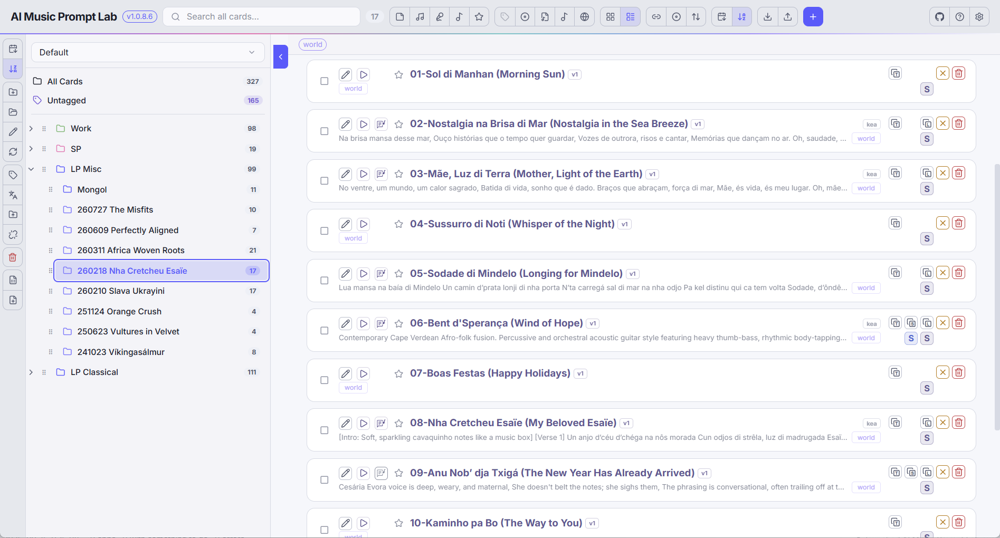

<p align="center">
  
</p>

<h1 align="center">AI Music Prompt Lab</h1>

<div align="center">
  <strong>Build a prompt once. Reuse it in every song.</strong><br>
  A workspace for your Suno prompts — reusable Music and Vocal styles, nested projects, AI generation and export.
</div>

<br>

<!-- readme:nav -->

<div align="center">
  <a href="../../releases/latest"></a>
  <a href="../../releases"></a>
</div>

<h3 align="center">
  <a href="https://apps.yaiol.com/p/ai-music-prompt-lab/">Website</a>
  <span>&nbsp;·&nbsp;</span>
  <a href="#install">Install</a>
  <span>&nbsp;·&nbsp;</span>
  <a href="#what-it-is">Features</a>
  <span>&nbsp;·&nbsp;</span>
  <a href="#documentation">Documentation</a>
  <span>&nbsp;·&nbsp;</span>
  <a href="#build-from-source">Development</a>
</h3>

<div align="center">
  <sub><a href="https://apps.yaiol.com/p/ai-music-prompt-lab/help/"><b>Help in 28 languages</b></a></sub>
</div>

<!-- /readme:nav -->

---

<p align="center">
  
</p>

---

## Install

<div align="center">

<table align="center">
<tr>
<th align="center">Windows</th>
<th align="center">macOS</th>
<th align="center">Linux</th>
</tr>
<tr>
<td align="center"><a href="../../releases/latest"></a></td>
<td align="center"><a href="../../releases/latest"></a></td>
<td align="center"><a href="../../releases/latest"></a></td>
</tr>
<tr>
<td align="center">x64 installer</td>
<td align="center">.dmg, not code-signed</td>
<td align="center">.deb and AppImage</td>
</tr>
</table>

</div>

> **Windows note:** SmartScreen may warn on first launch because the app is not code-signed. Click "More info", then "Run anyway".

---

## What it is

If you use Suno or another AI music generator seriously, you end up with dozens or hundreds of prompts scattered across notes files, rewriting the same style text into every new song. AI Music Prompt Lab replaces that flat pile with a real workspace.

The core idea is that prompts are reusable building blocks, not one-off text. You build a Music style and a Vocal style once, then combine them into any number of Songs instead of rewriting prompts every time. Everything lives in nested projects with search, tags, filters, lyric translation, media linking and export - and Google Gemini can write or refine styles and whole songs for you. Then you copy the result straight into Suno.

---

## Features

- **Reusable style cards** - build Music and Vocal styles once, then combine them into any number of Songs instead of rewriting prompts every time.
- **AI generation and Song Wizard** - Google Gemini writes styles and whole songs, from your own templates or from just an artist and a subject. Custom templates with per-block preset editors and smart variables.
- **A real workspace** - organize hundreds of cards in nested projects and separate environments, with search, tags and filters; grid or list view, multiple sort modes.
- **Lyric translation** - translate any song's lyrics into other languages, by hand or with AI, and keep every version on the card.
- **Media linking and export** - link audio files to songs, hand off to the LRC editor, and export to JSON, XLSX or DOCX (import from a JSON snapshot).
- **Cards from a link** - copy a song link from Suno and hit New: the card opens filled in with its title, number, style, lyrics and date.
- **Open an LP file** - double-click a `.amlp` prompt file and it lands as a project with one Song card per track; Export writes one back out.
- Dark and light themes, 3 fonts, 52 languages (including RTL).

---

## Documentation

| | |
|---|---|
| **User manual** | [Read it online](https://apps.yaiol.com/p/ai-music-prompt-lab/help/) |
| **Printable PDF** | attached to each [release](../../releases/latest) |
| **What's new** | [Release notes](https://apps.yaiol.com/p/ai-music-prompt-lab/help/releases/) |
| **Product page** | [apps.yaiol.com](https://apps.yaiol.com/p/ai-music-prompt-lab/) |

---

## Build from source

Requires the Rust toolchain (stable) and, for the installer, the Dioxus CLI (`cargo install dioxus-cli --version 0.7.10 --locked`).

```bash
cargo run                                                       # run in development
cd app && dx bundle --desktop --release --package-types nsis    # Windows installer → release/
```

---

## Architecture

A Cargo workspace of two crates. Everything is local: a SQLite database (`ampl.db`) in the app's data folder, no cloud.

- `engine/` — everything that is not the window: the card database, projects and environments, JSON / `.amlp` import and export, the XLSX and DOCX writers, the Gemini request, FLAC / MP3 / M4A tag reading and writing, and a small local server the player reads songs from. No UI dependency.
- `app/` — the Dioxus desktop shell: the card grid and list, the card dialog, the Sort / Link / Media working views, the AI dialog, the Song Wizard, settings, the footer player. The look comes from the shared stylesheet in `app/assets/`; strings come from `locales/<lang>.json`, embedded in the executable at build time.

| Layer | Technology |
|---|---|
| UI | Dioxus 0.7 (system WebView) |
| Database | SQLite (rusqlite, bundled) |
| AI generation | Google Gemini API |
| Audio tags | lofty |
| Export | rust_xlsxwriter (XLSX), DOCX written directly |

<details>
<summary><b>Data model</b></summary>

The store centres on a single `card` table: a card is a `music`, `vocal`, `song` or `note`, with its style content, lyrics, tags and an optional project. Cards link to each other (`card_link`: a Song references its Music and Vocal cards), to external URLs (`url`) and to translations (`card_translation`). A card belongs to exactly one project or none; projects nest, and each lives in an `environment`. A separate set of tables (`ai_block_preset`, `ai_template`, `ai_template_block`, `ai_wizard`, `ai_wizard_task`) backs the AI authoring system.

</details>

<details>
<summary><b>AI authoring pipeline</b></summary>

The system prompts Gemini runs ship as a seed file, `engine/assets/ai-music.json`, embedded in the executable. It is generated from a flat text source, so the deeply nested JSON is never hand-edited. On every launch the app reconciles that seed into the database: default presets and templates are upserted, removed defaults are cascade-deleted, and user-created ones are never touched. On top of this sit the AI Generate dialog (Simple and Expert modes) and a multi-step **Song Wizard** that turns an artist plus a subject into a style and lyrics.

</details>

---

## License

Released under the [MIT License](LICENSE).

<div align="center">
  <sub>AI Music Prompt Lab is part of <a href="https://apps.yaiol.com">yaiol Applications</a>.</sub>
</div>
